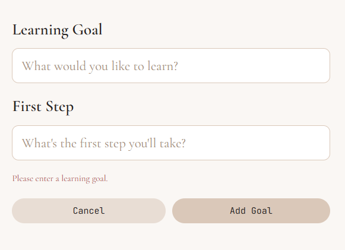
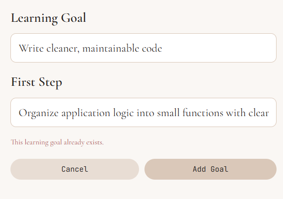
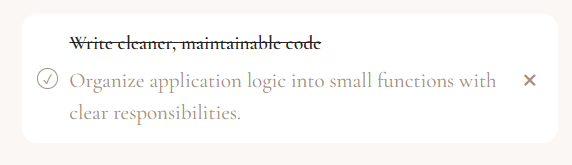
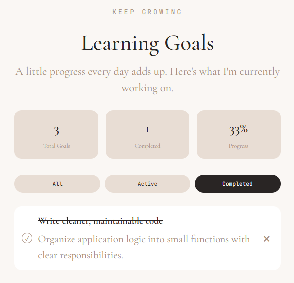
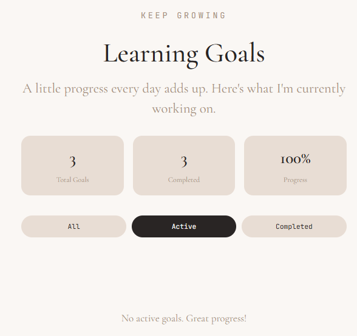

# Manual Test Cases

## Project: Interactive Portfolio

This document describes the manual tests performed to verify the functionality, validation, data persistence, and responsiveness of the interactive portfolio.

**Testing method:** Manual testing in a web browser  
**Overall result:** All 15 test cases passed successfully.

## Test Cases

| ID | Test Scenario | Expected Result | Actual Result |
|---|---|---|---|
| TC-01 | Submit an empty goal | An error message is displayed and no goal is added. | The application displayed a validation error and prevented the empty goal from being added. |
| TC-02 | Submit a goal containing only whitespace | The input is rejected. | The whitespace-only input was rejected and the goals list remained unchanged. |
| TC-03 | Add an existing goal | A duplicate validation error is displayed. | The application detected the existing goal and prevented duplication. |
| TC-04 | Add a duplicate with different capitalization and surrounding spaces | The duplicate is rejected regardless of capitalization or extra spaces. | The application correctly identified the normalized text as a duplicate and rejected it. |
| TC-05 | Add a valid new goal | The goal is added as active and the total count increases. | The new goal appeared in the list with active status and the statistics updated correctly. |
| TC-06 | Mark an active goal as completed | The goal becomes completed and the statistics update. | The goal status changed to completed and the completed count and percentage updated correctly. |
| TC-07 | Mark a completed goal as active | The goal becomes active again and the statistics update. | The goal returned to active status and the statistics were recalculated correctly. |
| TC-08 | Cancel goal deletion | The goal remains unchanged. | The confirmation dialog was dismissed and the goal remained in the list. |
| TC-09 | Confirm goal deletion | The selected goal is removed and the statistics update. | The selected goal was deleted and the statistics updated accordingly. |
| TC-10 | Switch between All, Active and Completed filters | Only matching goals are displayed without changing the overall statistics. | Each filter displayed the correct goals and the overall statistics remained unchanged. |
| TC-11 | Reload the page after modifying goals | Goals and their completion statuses are preserved. | All goals and their statuses were restored correctly after reloading the page. |
| TC-12 | Delete all goals and reload the page | The list remains empty, an empty-state message appears, and all statistics show zero. | The empty state was displayed correctly, the statistics showed zero values, and no goals reappeared after reloading. |
| TC-13 | Change the theme and reload the page | The selected theme is preserved. | The selected theme remained active after reloading the page. |
| TC-14 | Select a filter with no matching goals | An appropriate empty-state message is displayed. | The application displayed the correct empty-state message for the selected filter. |
| TC-15 | Open the application on a mobile screen | The layout adapts to the screen width without horizontal overflow. | The layout adapted correctly to the mobile viewport and no horizontal overflow occurred. |

## Screenshots

Selected screenshots are included as visual evidence of the tested functionality.

### Empty Input Validation

### Duplicate Goal Validation

### Completed Goal and Statistics

### Goal Filtering

### Empty State

## Conclusion

All 15 manual test cases passed successfully. The application meets the tested functional requirements, including goal management, input validation, filtering, progress statistics, localStorage persistence, theme persistence, and responsive layout.

No outstanding issues were identified during the final manual testing.